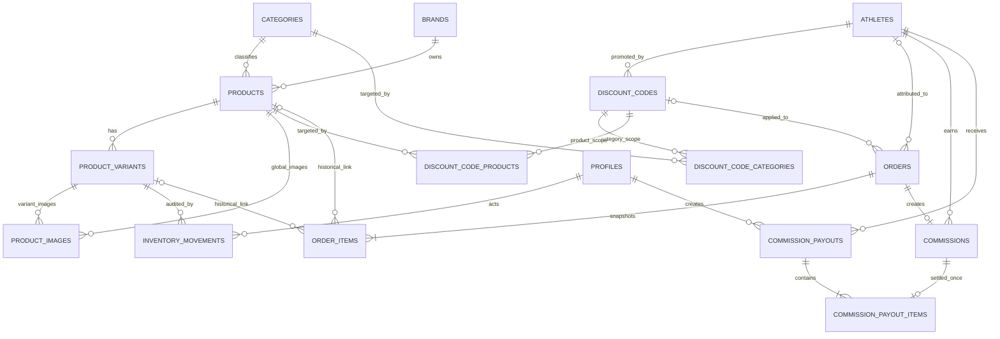

# عالم اللياقة — معمارية الخلفية (Phase 2A)

هذه المرحلة تصف قاعدة بيانات محلية فقط. لم تُربط بمشروع Supabase بعيد، ولم تُنشأ بيانات إنتاج أو أسرار. ملفات SQL مرتبة داخل `supabase/migrations` ويجب مراجعتها في بيئة Supabase محلية قبل أي نشر بعيد.

## مبادئ لا تقبل الالتفاف

- PostgreSQL هو مصدر الحقيقة للسعر والمخزون والخصم والإجمالي والعمولة وحالات الطلب والعمولة.
- نطاق الكتالوج حصري للمكملات الرياضية وإكسسوارات اللياقة، ولا تمتد المعمارية المستقبلية إلى فئات أخرى.
- العميل يرسل معرّفات المتغيرات والكميات وبيانات العميل والكود الاختياري فقط. لا يقبل `submit_order` سعرًا أو مجموعًا أو نسبة خصم أو عمولة من العميل.
- كل مبالغ LYD تستخدم `numeric(12,3)`، وليس `real` أو `double precision`. تدعم الدقة ثلاث منازل عشرية لأن الدينار الليبي مقسم إلى 1000 درهم.
- الطلبات وعناصرها والعمولات والدفعات سجلات تاريخية. الكتالوج يُؤرشف، ولا تستخدم علاقات cascade تمحو سجلًا ماليًا.
- لا تستخدم `service_role` داخل المتصفح. العمليات العامة المسموح بها تمر من دوال محددة ومحصنة، والعمليات الإدارية تعتمد على `auth.uid()` ودور محفوظ في قاعدة البيانات.

## مخطط العلاقات



## تسلسل الهجرات

1. `001_foundation_and_catalog.sql`: الأدوار، العلامات، الفئات، المنتجات، والتحديث التلقائي لـ`updated_at`.
2. `002_product_variants_and_images.sql`: المتغيرات والصور العامة/الخاصة بالمتغير.
3. `003_inventory.sql`: دفتر حركات المخزون.
4. `004_athletes_and_discount_codes.sql`: الرياضيون والأكواد المستقلة الخصم/العمولة ونطاقات global/category/product.
5. `005_orders.sql`: الطلبات ولقطات عناصرها وربط حركات المخزون بالطلبات.
6. `006_commissions.sql`: العمولات والدفعات وجدول الربط بينهما.
7. `007_rls_and_security.sql`: سياسات RLS والصلاحيات العامة والإدارية.
8. `008_trusted_commerce_functions.sql`: حدود المعاملات الموثوقة للطلب والمخزون والحالات والدفعات.

الترتيب متعمد: لا يُنشأ مفتاح أجنبي قبل الجدول الذي يعتمد عليه. `inventory_movements.order_id` يبدأ كعمود UUID ثم يضاف مفتاحه بعد إنشاء `orders` في الهجرة 005.

## الكتالوج والمتغيرات

`products` يحمل المحتوى المشترك: slug ثابت، الاسمان، الوصفان، العلامة، الفئة، الحالة، التمييز، نوع المنتج، الهدف، وقائمة highlights بسيطة. الحالات: `draft`, `active`, `archived`.

الفئات المسموحة تجاريًا تنتمي إلى مجموعتين فقط: المكملات الرياضية وإكسسوارات اللياقة. لا تُنشأ فئات أو منتجات خارج هاتين المجموعتين.

`product_variants` هو الكيان القابل للبيع وصاحب السعر وSKU والمخزون. النكهة والوزن والحجم والحصص اختيارية، لذلك:

- الكرياتين قد يستخدم الوزن فقط.
- البروتين قد يستخدم النكهة والوزن.
- إكسسوارات اللياقة قد تستخدم `size_label_*` أو مفاتيح قليلة مثل اللون والخامة في `attributes`.

`attributes` كائن JSON صغير للأبعاد المستقبلية النادرة، وليس نظام ERP عام. SKU فريد دون حساسية لحالة الأحرف. السعر غير سالب، وسعر المقارنة — إن وجد — لا يقل عن السعر الحالي.

## سلوك الصور

`product_images.variant_id IS NULL` تعني صورة عامة للمنتج. وجود `variant_id` يعني صورة خاصة بالمتغير. مفتاح أجنبي مركب `(variant_id, product_id)` يمنع ربط صورة بمتغير تابع لمنتج آخر.

ترتيب العرض المستقبلي:

1. من دون اختيار متغير: الصور العامة، مع `is_primary` أولًا ثم `sort_order`.
2. بعد اختيار متغير: صور المتغير أولًا.
3. إذا لم تكفِ صور المتغير: تضاف الصور العامة كبديل.

كل صف صورة يقبل إما `storage_path` أو `external_url` وليس كليهما. Storage لم يُنشأ في هذه المرحلة.

## المخزون والتزامن

`product_variants.stock_quantity` هو الرصيد الحالي السريع. `inventory_movements` دفتر تدقيق غير قابل للاستبدال يضم التغير الموقّع والرصيد الناتج والسبب والطلب والمشرف الاختياري.

`submit_order` يجمع الأسطر المكررة، يرتب UUIDs، ويقفل صفوف المتغيرات بـ`FOR UPDATE` قبل التحقق والخصم. هذا يمنع عميلين من شراء آخر وحدة في الوقت نفسه. تحديث الرصيد وحركة `sale` يحدثان في المعاملة نفسها.

التعديلات اليدوية تمر عبر `adjust_inventory` الإدارية. إلغاء الطلب عبر `set_order_status` يعيد الكمية ويسجل `order_cancelled_return`. لا توجد مستودعات متعددة في هذه المرحلة.

## الرياضيون والأكواد

`athletes` مستقل عن الطلبات، ويمكن للرياضي امتلاك أكثر من صف في `discount_codes` على مر الزمن. تعطيل الرياضي أو الكود مفضل على الحذف.

كل كود يخزن نسبتين مستقلتين وإلزاميتين يضبطهما المشرف يدويًا:

- `customer_discount_percent`: ما يحصل عليه العميل.
- `athlete_commission_percent`: ما يكسبه الرياضي.

لا توجد نسبة افتراضية يختارها الخادم. قاعدة البيانات تتحقق فقط من أن كل نسبة بين 0 و100، وأن إحدى النسبتين على الأقل أكبر من صفر، وأن العمولة لا تكون موجبة دون رياضي مرتبط. أمثلة إعدادات صحيحة يختارها المشرف: `8/5` أو `12/9` أو `20/0` (خصم العميل/عمولة الرياضي).

يدعم الكود وقت بداية ونهاية، حد استخدام، عداد استخدام مقفول، حدًا أدنى للمجموع المؤهل، وربطًا اختياريًا برياضي. `scope_type` يكون واحدًا من:

- `global`: كل عناصر الطلب مؤهلة.
- `category`: العناصر التابعة للفئات المدرجة في `discount_code_categories` فقط.
- `product`: المنتجات المدرجة في `discount_code_products` فقط.

لا يسمح المشغل بإضافة هدف فئة أو منتج لا يطابق `scope_type`. الأكواد ذات النطاق المقيد ومن دون أهداف تُرفض عند الطلب. جدول الأكواد وجداول نطاقه خاصة ولا توجد لها سياسة قراءة عامة. التحقق يتم داخل `submit_order` بعد تحميل الأسعار والتصنيفات الموثوقة.

قرار Phase 2A الحالي: `redemption_count` يحسب الطلب المقبول حتى لو أُلغي لاحقًا، للحد من إساءة إعادة استخدام الأكواد المحدودة. تغيير هذه القاعدة يحتاج موافقة تجارية.

## الحساب الموثوق

داخل `submit_order`:

```text
subtotal = Σ(database variant price × requested quantity)
qualifying_subtotal = Σ(trusted matching line price × quantity)
discount_amount = round(qualifying_subtotal × admin-set customer_discount_percent / 100, 3)
total = subtotal - discount_amount
commission_amount = round(qualifying_subtotal × admin-set athlete_commission_percent / 100, 3)
```

العمولة مبنية على المجموع المؤهل الأصلي قبل خصم العميل. النسبتان لا تؤثر إحداهما في الأخرى ولا تختارهما الدالة. في كود `global` يساوي المجموع المؤهل مجموع الطلب، أما نطاق الفئة أو المنتج فيستبعد الأسطر غير المطابقة من الخصم والعمولة مع بقائها في إجمالي الطلب.

## الطلبات والنزاهة التاريخية

حالات الطلب: `pending → confirmed → preparing → delivered`، ويمكن الإلغاء قبل التسليم. `set_order_status` يفرض الانتقالات المسموحة.

`orders` يحتفظ بالمبالغ الموثوقة ولقطة الكود ونطاقه والمجموع المؤهل ونسبة خصم العميل وربط الرياضي. `order_items` يحتفظ بلقطات الاسم ووصف المتغير وSKU وسعر الوحدة والكمية وإجمالي السطر. علاقات المنتج والمتغير قابلة لأن تصبح NULL إذا أزيل سجل كتالوج، لكن اللقطات تبقى مفهومة. عمليًا، وجود حركات مخزون تاريخية يمنع حذف المتغير، والأرشفة هي المسار الموصى به.

لا توجد سياسة إدخال مباشر للعميل على الطلبات أو عناصرها. إنشاء الطلب العام محصور في RPC `submit_order`.

## دورة حياة العمولة والدفع

- طلب مؤهل جديد: `pending`.
- تسليم الطلب عبر `set_order_status`: `approved` مع `approved_at`.
- إلغاء الطلب قبل التسليم: `void` مع `voided_at` وإرجاع المخزون.
- صرف إداري عبر `create_commission_payout`: `paid` مع `paid_at`.

`commissions` يخزن أساس الحساب والنسبة والمبلغ ولقطة الكود، لذلك لا يتغير التاريخ عند تغيير الرياضي أو الكود لاحقًا. `commission_payouts` هو رأس عملية الدفع، و`commission_payout_items` يسمح لدفعة واحدة بجمع عدة عمولات لرياضي واحد، مع قيد يمنع دفع العمولة نفسها مرتين. المشغل يتحقق أيضًا من تطابق رياضي الدفعة والعمولة.

## نموذج الأمان وRLS

`profiles.role = 'admin'` مع `active = true` و`auth.uid()` هو مصدر التفويض الإداري. الدالة `is_admin()` ذات `security definer` ومسار بحث فارغ تمنع الاعتماد على قيمة مرسلة من الواجهة.

| البيانات | anon | authenticated غير إداري | إداري |
|---|---|---|---|
| العلامات/الفئات النشطة | قراءة | قراءة | إدارة كاملة |
| المنتجات النشطة | قراءة | قراءة | إدارة كاملة |
| المتغيرات والصور النشطة | قراءة | قراءة | إدارة كاملة |
| الرياضيون والأكواد ونطاقاتها | لا وصول | لا وصول | ضبط النسب والنطاقات يدويًا دون حذف السجل التاريخي |
| الطلبات والعناصر | RPC فقط | RPC فقط | قراءة، وتغيير الحالة عبر RPC الموثوق |
| المخزون/العمولات/الدفعات | لا وصول | لا وصول | قراءة، والكتابة عبر RPCs الموثوقة |
| الملف الشخصي | لا وصول | قراءة صفه فقط | إدارة كاملة |

كل الجداول مفعّل عليها RLS. `submit_order` ممنوحة فقط لـ`anon` و`authenticated` وتنفذ بمالك موثوق؛ الدوال الإدارية تتحقق من `is_admin()` داخليًا. لا يجب منح مفاتيح `service_role` لتطبيق المتصفح.

حركات المخزون وعناصر الطلب والدفعات وعناصرها append-only على مستوى المشغلات. كما تمنع مشغلات أخرى تعديل الحقول المالية التاريخية أو القفز بين حالات الطلب/العمولة بانتقالات غير مشروعة.

ملاحظة تشغيلية: إنشاء أول صف admin عملية bootstrap يدوية في بيئة آمنة بعد إنشاء مستخدم Supabase Auth؛ لا يملك المستخدم العام سياسة لترقية نفسه.

## تدفق `submit_order`

المدخل العام المتوقع:

```json
{
  "p_customer_full_name": "...",
  "p_customer_phone": "...",
  "p_customer_city": "...",
  "p_customer_address": "...",
  "p_items": [{ "variant_id": "uuid", "quantity": 2 }],
  "p_customer_notes": null,
  "p_code": "AHMED10"
}
```

الدالة تتحقق من البنية، تجمع التكرار، تقفل المخزون، تحمل الأسعار والتصنيفات الحقيقية، تقفل الكود، تحدد الأسطر المؤهلة حسب نطاقه، تستخدم نسب المشرف كما هي، تنشئ الطلب واللقطات والعمولة، تخفض المخزون، وتسجل الحركات. أي خطأ يرمي الاستثناء ويلغي المعاملة كاملة.

الناتج يحتوي فقط على `order_id`, `order_number`, `currency`, `subtotal`, `code_qualifying_subtotal`, `discount_amount`, و`total` المحسوبة في الخادم.

## ربط نموذج Phase 1 لاحقًا

لا يلزم تعديل أنواع الواجهة الآن. خريطة التحويل المقترحة:

| نوع الواجهة | مصدر قاعدة البيانات |
|---|---|
| `Product.id` | `products.id` |
| `Product.slug` | `products.slug` |
| `brand` | `brands.name_ar` عبر `brand_id` |
| `name`, `shortName`, `description` | حقول المحتوى العربية في `products` |
| `category` | `categories.name_ar` |
| `goal`, `type`, `features`, `badge` | `training_goal`, `product_type`, `highlights`, `badge_label_ar` |
| `images` | صور `product_images` العامة المرتبة |
| `inStock` | مشتق من وجود متغير نشط بـ`stock_quantity > 0` |
| `ProductVariant.id` | `product_variants.id` |
| `flavor`, `weight`, `servings` | حقول المتغير؛ `weight` يُصاغ من القيمة والوحدة |
| `price`, `compareAtPrice`, `stock` | `price`, `compare_at_price`, `stock_quantity` |
| `ProductVariant.images` | صور المتغير ثم الصور العامة الاحتياطية |
| `rating`, `reviewCount` | نظام مراجعات لاحق؛ لا تُختلق قيم مالية/تقييمية في المخطط الحالي |

سعر JavaScript سيظل `number` للعرض فقط. قبل إرسال طلب لا تُرسل الواجهة السعر إطلاقًا. وعند إضافة عميل Supabase لاحقًا، يفضل تحويل قيم `numeric` النصية إلى طبقة عرض منفصلة بدل إجراء حسابات مالية موثوقة في JavaScript.

## قيود وفهارس مقصودة

- slugs فريدة ومستقرة، وSKU فريد دون حساسية لحالة الأحرف.
- النسب بين 0 و100، الأسعار والمخزون غير سالبة، وإجماليات السطر والرأس متطابقة حسابيًا.
- نسب الخصم والعمولة بلا defaults تجارية؛ يجب على المشرف تعيينهما صراحة لكل كود.
- نطاق الكود مقيد إلى global/category/product، وأهداف الفئة/المنتج لا تقبل نوع نطاق مختلفًا.
- صورة المتغير لا يمكن أن تنتمي إلى منتج مختلف.
- لا يمكن ربط عمولة بأكثر من دفعة، ولا خلط رياضيين في دفعة واحدة.
- فهارس على علاقات الكتالوج، قوائم المتجر النشطة، تاريخ مخزون المتغير، حالة الطلب وتاريخه، هاتف العميل، وعملة الرياضي وحالتها. لم تُضف فهارس بلا مسار استعلام متوقع.

## قرارات مطلوبة قبل النشر البعيد

1. هل الطلبات الملغاة تبقى محسوبة ضمن حد استخدام الكود، كما هو حاليًا؟
2. هل يسمح الإلغاء بعد التسليم/الإرجاع؟ المخطط الحالي يجعل `delivered` نهائية ويحتاج تدفق returns منفصلًا لاحقًا.
3. قواعد تنسيق والتحقق الفعلية لأرقام الهاتف والمدن الليبية.
4. من يملك صلاحية bootstrap لأول admin، ومن يراجع تغيير الأدوار؟
5. اسم Storage bucket، هل سيكون عامًا أم موقّعًا، وحدود أنواع/أحجام الصور.
6. سياسة الضرائب والشحن؛ المخطط الحالي يحسب سعر المنتجات والخصم فقط ولا يخترع قواعد غير معتمدة.
7. هل يسمح بأكثر من كود واحد للطلب مستقبلًا؟ التصميم الحالي يتعمد دعم كود واحد فقط ومنع تراكب الخصومات.
8. بيئة اختبار محلية وبيانات seed غير إنتاجية مقتصرة على المكملات وإكسسوارات اللياقة قبل أي `supabase db push` بعيد.

سيناريوهات التحقق المقترحة موثقة في `docs/backend-test-scenarios.md`. لا توجد بيانات seed في Phase 2A، وبالتالي لا توجد فئات خارج النطاق أو نسب افتراضية مخزنة ينبغي ترحيلها.
